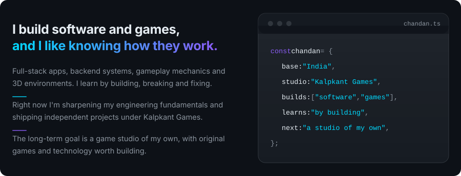
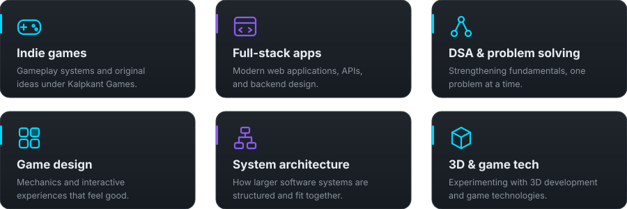
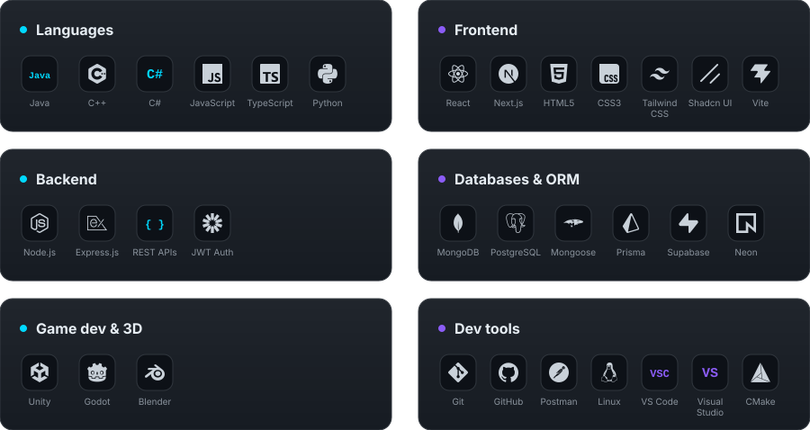
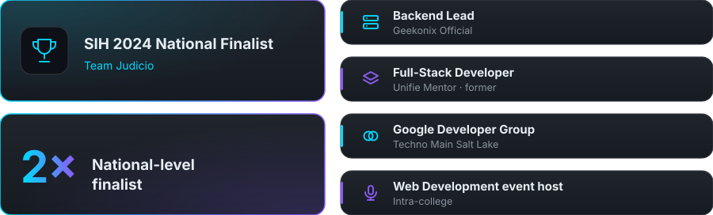
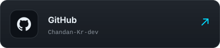
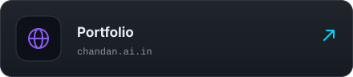
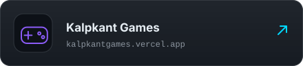

<!-- ============================================================
  Chandan Kumar — GitHub Profile README
  Theme: Midnight Developer
  bg #0D1117 · surface #161B22 · primary #00D9FF · secondary #8B5CF6

  Every section is a self-contained SVG in ./assets (no external fonts or
  scripts), so it renders the same on GitHub light and dark themes.
  To change text, edit the matching .svg file.
============================================================ -->

  

 

 

 

 

<b>Project details</b>

 

**🕵️ The Last Room** · *Detective / Mystery / Investigation*

A detective mystery game where you investigate a crime scene, collect evidence, examine clues, question suspects, and uncover the truth behind a mysterious case. First-person exploration, interactive evidence, suspect dialogue, evidence analysis, and deduction and accusation systems.
`Unity` `C#` `Game Development` · [Website](https://kalpkantgames.vercel.app/)

<!-- Repository: add link here when public -->

**🌀 MazeEscape** · *3D Maze / Casual*

A 3D maze game where you find your way through challenging levels, collect coins, and use hints when you're stuck. 3D maze gameplay, mobile controls, coin collection, a hint system, and multiple levels.
`Unity` `C#` `3D Game Development`

<!-- Repository / download link: add here when available -->

**🎮 Kalpkant Games** · *Indie Game Development Platform*

My independent game development brand and platform, built to showcase my games, explore original ideas, and create gaming experiences.
`Web Development` `Game Development` `Independent Projects` · [Visit](https://kalpkantgames.vercel.app/)

**Prototypes & concepts**

- **Don't Let It See You** (horror / stealth prototype): a survival mechanic where the creature reacts to your visibility and movement, building tension through observation and timing. `Unity` `C#` `Gameplay Programming`
- **One Move** (puzzle concept): every level has to be solved with a single move. Quick challenges, logical thinking, short sessions. `Unity` `C#` `Game Design`

 

 

 

  

 

