<!-- ============================================================
  Chandan Kumar — GitHub Profile README
  Theme: Midnight Developer
  bg #0D1117 · surface #161B22 · primary #00D9FF · secondary #8B5CF6
  Keep this file in the repo root, and the ./assets folder beside it.
============================================================ -->

 

 

## About

I'm Chandan, a software developer and indie game developer from India. I build across the stack, from backend systems and web apps to gameplay mechanics and 3D environments, and I like understanding how things work under the hood.

I learn by building: make it, break it, fix it, ship it. Right now that means sharpening my engineering fundamentals and taking independent projects from idea to working product under **Kalpkant Games**. The long-term goal is a game studio of my own, original games, and technology worth building.

 

## Currently Building & Exploring

<table>
  <tr>
    <td width="33%" valign="top">
      <b>🎮 Indie games</b> 
      Gameplay systems and original ideas under Kalpkant Games.
    </td>
    <td width="33%" valign="top">
      <b>🌐 Full-stack apps</b> 
      Modern web applications, APIs and backend design.
    </td>
    <td width="33%" valign="top">
      <b>🧠 DSA & problem solving</b> 
      Strengthening fundamentals, one problem at a time.
    </td>
  </tr>
  <tr>
    <td valign="top">
      <b>🕹️ Game design</b> 
      Interactive experiences and mechanics that feel good to play.
    </td>
    <td valign="top">
      <b>🏗️ System architecture</b> 
      Learning how larger software systems are structured.
    </td>
    <td valign="top">
      <b>🧊 3D & game tech</b> 
      Experimenting with 3D development and game technologies.
    </td>
  </tr>
</table>

 

## Tech Stack

**Languages**

**Frontend**

 

**Backend**

 

**Databases & ORM**

 

**Game Development & 3D**

**Tools**

 

## Featured Projects

<b>Project details</b>

 

**🕵️ The Last Room** · *Detective / Mystery / Investigation*

A detective mystery game where you investigate a crime scene, collect evidence, examine clues, question suspects, and uncover the truth behind a mysterious case. First-person exploration, interactive evidence, suspect dialogue, evidence analysis, and deduction and accusation systems.
`Unity` `C#` `Game Development` · [Website](https://kalpkantgames.vercel.app/)

<!-- Repository: add link here when public -->

**🌀 MazeEscape** · *3D Maze / Casual*

A 3D maze game where you find your way through challenging levels, collect coins, and use hints when you're stuck. 3D maze gameplay, mobile controls, coin collection, a hint system, and multiple levels.
`Unity` `C#` `3D Game Development`

<!-- Repository / download link: add here when available -->

**🎮 Kalpkant Games** · *Indie Game Development Platform*

My independent game development brand and platform, built to showcase my games, explore original ideas, and create gaming experiences.
`Web Development` `Game Development` `Independent Projects` · [Visit](https://kalpkantgames.vercel.app/)

**Prototypes & concepts**

- **Don't Let It See You** (horror / stealth prototype): a survival mechanic where the creature reacts to your visibility and movement, building tension through observation and timing. `Unity` `C#` `Gameplay Programming`
- **One Move** (puzzle concept): every level has to be solved with a single move. Quick challenges, logical thinking, short sessions. `Unity` `C#` `Game Design`

 

## Experience & Achievements

| | |
|---|---|
| 🏆 **SIH 2024 National Finalist** | Team Judicio |
| 🥇 **2× National-Level Finalist** | Hackathons & competitions |
| 💼 **Full-Stack Developer** | Unifie Mentor *(former)* |
| ⚙️ **Backend Lead** | Geekonix Official |
| 🌱 **Google Developer Group** | Techno Main Salt Lake |
| 🎤 **Event Host** | Intra-college Web Development event |

 

## GitHub Stats

 

## Contribution Activity

 

## Connect

  

Built with curiosity · Chandan Kumar · India

